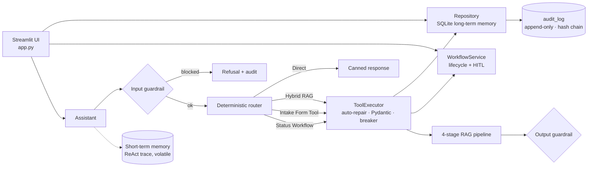

# Pharma Safety Intake & Triage Tracker

A **local, synthetic-data training prototype** that captures fictional product quality complaints and suspected adverse event reports. It enforces mandatory-field validation, tracks reports through a **New → In Review → Closed** lifecycle with a **human-in-the-loop closure gate**, and keeps an **immutable, hash-chained audit trail**. A knowledge assistant answers historical lookups over SOPs and past reports, using a **4-stage hybrid RAG pipeline** and a **deterministic agentic control plane**.

> ⚠️ **Fictional data only. Non-clinical.** The application never assesses causality, recommends treatment, determines regulatory reportability, or makes clinical or regulatory decisions. It is not a pharmacovigilance system. Everything runs locally: no cloud services, no external APIs, no API keys.

  

---

## Quick start

```bash
git clone <your-repo-url> && cd <repo>
python -m venv .venv
# Windows: .venv\Scripts\activate      macOS/Linux: source .venv/bin/activate
cd pharma_intake_tracker

# 1) Core install (app + deterministic fallback RAG + tests)
pip install -r requirements.txt

# 2) Optional but recommended: real local RAG models (~1 GB incl. CPU torch, ~270 MB of models)
pip install torch --index-url https://download.pytorch.org/whl/cpu
pip install -r requirements-models.txt
python scripts/download_models.py        # the ONLY networked step; runtime is offline

# 3) Fictional history for the knowledge base, then launch
python scripts/seed.py
streamlit run app.py                     # http://127.0.0.1:8501 (bound to loopback)
```

| Task | Command (run inside `pharma_intake_tracker/`) |
|---|---|
| Run all tests | `python -m pytest` |
| Run tests as CI does (no models) | `PHARMA_RAG_MODE=fallback python -m pytest` |
| Regenerate demo evidence | `python scripts/demo_run.py` → `docs/DEMO_OUTPUT.md` |
| Reset the local database | `python scripts/seed.py --reset` |
| Check model download | `python scripts/download_models.py --check` |

### Configuration (environment variables, all optional)
| Variable | Default | Meaning |
|---|---|---|
| `PHARMA_DB_PATH` | `data/tracker.db` | SQLite file (git-ignored) |
| `PHARMA_RAG_MODE` | `auto` | `auto` = real models if downloaded, else fallback · `real` = required · `fallback` = deterministic only |
| `PHARMA_MODELS_DIR` | `models/` | Where `download_models.py` stores the models |
| `PHARMA_LLM_BACKEND` | `extractive` | `extractive` (deterministic, cited quotes) or `ollama` (local LLM) |
| `PHARMA_OLLAMA_URL` / `PHARMA_OLLAMA_MODEL` | `http://127.0.0.1:11434` / `llama3.2:3b` | Used only with `ollama`. **Loopback addresses only**; anything else is refused. |

---

## What it does

| Capability | Where |
|---|---|
| Unique reference `REF-YYYY-NNNN`, reserved atomically when a report is started | `src/pharma_intake/refgen.py`, `repository.py` |
| Categorisation: Suspected Adverse Event / Product Quality Complaint | `schemas.py` |
| Core fields plus AE extensions (event description, onset date), with no patient identifiers | `schemas.py`, `pii.py` |
| Mandatory-field validation with context-sensitive messages; all errors shown at once | `schemas.validate_intake` |
| Dashboard with filters by status and report type | `app.py` (Dashboard tab) |
| Lifecycle New → In Review → Closed, enforced in Python **and** by SQLite triggers | `workflow.py`, `db.py` |
| HITL gate: In Review → Closed freezes the report until a reviewer approves with an attestation | `workflow.py` |
| Local audit trail: append-only, SHA-256 hash chain, whitelisted details (no free text) | `audit.py` |
| 4-stage hybrid RAG: BM25 → bi-encoder → RRF → cross-encoder | `src/pharma_intake/rag/` |
| 5-step control plane: Pydantic tools, dual memory, deterministic router, HITL, circuit breaker and guardrails | `tools.py`, `src/pharma_intake/agent/` |

### Architecture



The RAG stages, parameters and models:

| Stage | Implementation | Spec parameters |
|---|---|---|
| 1 Lexical (BM25) | From-scratch Okapi BM25; codes like `LOT-88392` kept whole | k1 = 1.5 (validated in [1.2, 1.5]), b = 0.75, top-50 |
| 2 Dense (bi-encoder) | `BAAI/bge-small-en-v1.5`, normalised embeddings, cosine | 512-token chunks (model tokenizer), 64-token overlap, top-50 |
| 3 Fusion (RRF) | Σ 1/(k + rank), ranks only, no score normalisation | k = 60, top-50 from each list |
| 4 Rerank (cross-encoder) | `mixedbread-ai/mxbai-rerank-xsmall-v1`, sigmoid relevance | drop < 0.40, pass top ≤ 5 to the prompt |

When nothing clears the 0.40 threshold, the assistant answers "No sufficiently relevant record found" instead of guessing. The default generator only quotes retrieved sentences with source tags. Full diagrams are in [docs/WORKFLOW.md](docs/WORKFLOW.md).

---

## Capstone deliverables

| # | Deliverable | Evidence |
|---|---|---|
| 1 | Working application | `pharma_intake_tracker/app.py` · walkthrough: [docs/DEMO.md](docs/DEMO.md) |
| 2 | CLAUDE.md | [CLAUDE.md](CLAUDE.md) |
| 3 | Plan Mode output | [docs/PLAN.md](docs/PLAN.md) (approved before coding; deviations listed at the end) |
| 4 | Project review skill | [.claude/skills/pharma-intake-review/](.claude/skills/pharma-intake-review/SKILL.md) · invocation evidence: [docs/review-evidence.md](docs/review-evidence.md) |
| 5 | Governance hook | [.claude/settings.json](.claude/settings.json) + [.claude/hooks/log_edit.py](.claude/hooks/log_edit.py) · execution log: [logs/edit_audit.log](logs/edit_audit.log) |
| 6 | Automated test suite | `pharma_intake_tracker/tests/` (schemas, storage integrity, workflow/HITL, breaker, router/guardrails, RAG stages and pipeline, hook, offline guard, UI) · CI: [.github/workflows/ci.yml](.github/workflows/ci.yml) |
| 7 | Demonstration artifacts | [docs/DEMO_OUTPUT.md](docs/DEMO_OUTPUT.md) (generated by `scripts/demo_run.py`) |
| — | Defense and reflection | [docs/DEFENSE.md](docs/DEFENSE.md) · requirement-to-test matrix: [docs/ACCEPTANCE.md](docs/ACCEPTANCE.md) |

---

## Repository layout

```
.claude/                      settings.json (PostToolUse hook), hooks/log_edit.py, skills/pharma-intake-review/
.github/workflows/ci.yml      pytest on Ubuntu + Windows, Python 3.10 and 3.12 (fallback RAG mode)
CLAUDE.md                     persistent contract for AI coding agents
docs/                         PLAN, ACCEPTANCE, DEFENSE, DEMO, DEMO_OUTPUT, WORKFLOW, review-evidence
logs/edit_audit.log           governance hook execution log (paths + timestamps only)
pharma_intake_tracker/
  app.py                      Streamlit UI (5 tabs)
  data/sops/                  5 fictional SOPs (knowledge corpus)
  scripts/                    seed.py, demo_run.py, download_models.py
  src/pharma_intake/          config, db, schemas, pii, refgen, repository, audit, workflow, tools
    rag/                      text, chunker, corpus, bm25, dense, rrf, rerank, prompt, generator, pipeline
    agent/                    guardrails, router, breaker, memory, assistant
  tests/                      pytest suite (+ socket guard that blocks non-loopback network access)
```

## Testing notes
- `tests/conftest.py` installs a **socket guard** for the whole run, so any non-loopback connection fails the suite.
- Tests marked `models` need the downloaded models and are skipped automatically without them. CI runs in fallback mode. Run the full suite locally after `download_models.py`.
- Tests use temporary databases and a deterministic clock, so audit hashes are reproducible.

## Publishing to GitHub
The repository is initialised locally on branch `main`, with no commits yet. To publish it:
```bash
git config user.name  "Your Name"                         # once, if not configured globally
git config user.email "you@users.noreply.github.com"
git add -A
git status                                                # confirm: no .venv, models/, *.db, __pycache__
git commit -m "Pharma Safety Intake & Triage Tracker capstone"
git remote add origin https://github.com/<you>/<repo>.git
git push -u origin main
```
`.gitignore` keeps out the virtualenv, bytecode, SQLite databases and downloaded models, so the repository stays small and contains no runtime data. The app is designed for **local execution only**. Deploying it to a cloud host would contradict the case study's deployment constraint.

## License
[MIT](LICENSE). Training use with fictional data only.
