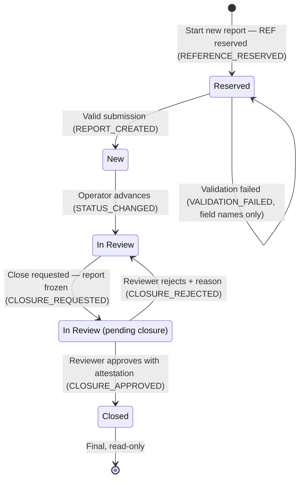
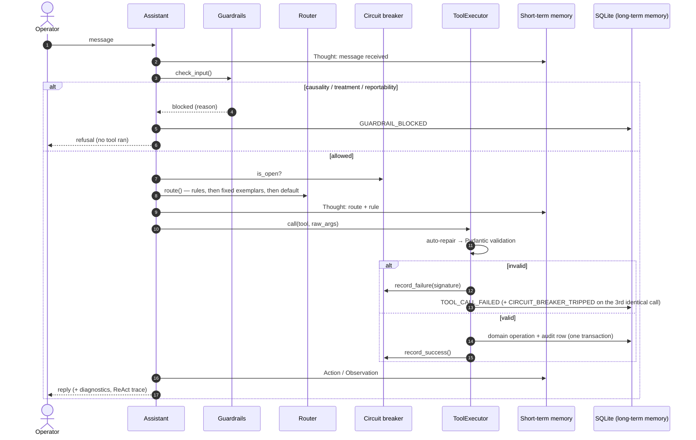
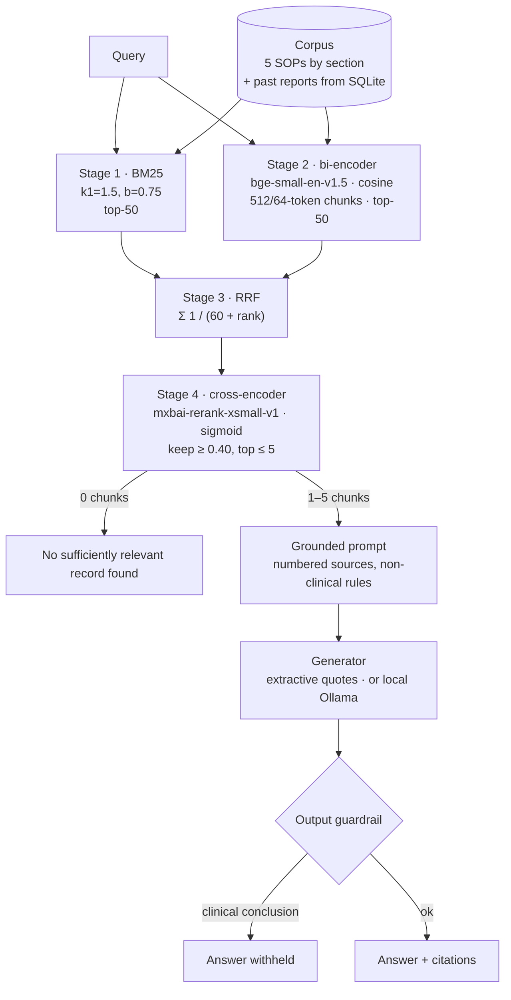
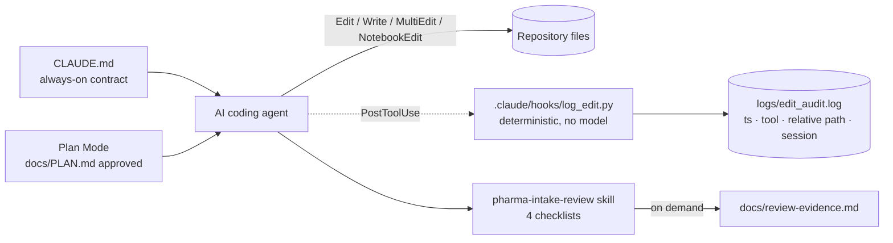

# Workflow and architecture diagrams

All diagrams are Mermaid, which GitHub renders inline.

## 1. Report lifecycle with the HITL gate

Everything not drawn is rejected: skipping New → Closed, moving backwards, any change after Closed, and any change while frozen. Each rule is enforced twice: in `workflow.py`, and by SQLite triggers in `db.py`. Only `REV-xx` identities can decide a closure, and only with the attestation ticked. The agent's tools can *request* a closure but have no approve capability.

## 2. Control plane — one assistant turn

## 3. 4-stage hybrid RAG

## 4. AI-assisted development governance

